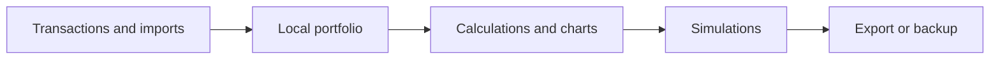

# InvestK

A local-first personal investment portfolio and analysis application.

**React, JavaScript, Vite, Recharts, SheetJS, REST APIs**

## What it does

- Tracks holdings, transactions, dividends and fixed-income positions.
- Includes projections, simulations, charts and spreadsheet import.
- Local persistence with export/import backups under the user’s control.

## Workflow



## Local setup and use

```powershell
npm ci
npm run dev
```
Use a maintained Node.js LTS release. `npm run build` produces the local production build; it does not publish it.

## Boundaries and limitations

This is a personal software project, not investment advice. Reference prices depend on external APIs. Simulations do not guarantee returns. Clearing browser storage can erase local data without a backup.

This is a source snapshot, not a claim of production readiness. Business results, dates and unmeasured performance are intentionally not asserted. Application UI language is preserved.

## License

Original application code is available under the [MIT license](LICENSE). Third-party libraries, models, fonts and bundled assets retain their own licenses.

## Verification record

See [snapshot checks and remaining limitations](docs/VERIFICATION.md).
